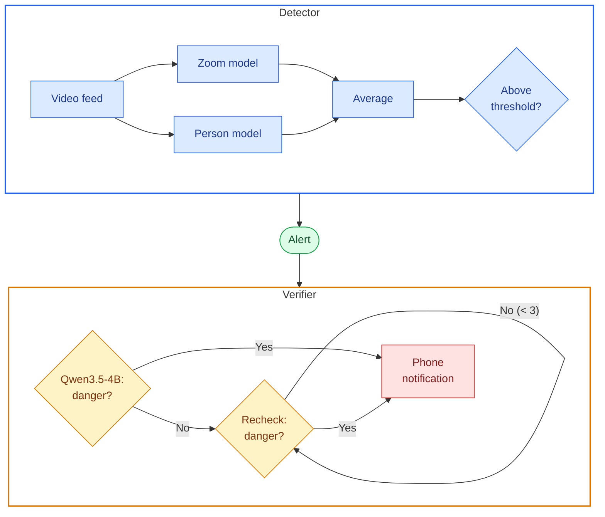

# VLM-Based Home Care System

A home monitoring system that detects when an elderly person falls or vomits on camera, double-checks each alert with a local multimodal LLM, and sends a notification to relatives' phones. Live footage is processed locally without being sent to the cloud.

The detector is [`microsoft/xclip-base-patch16`](https://huggingface.co/microsoft/xclip-base-patch16) fine-tuned with LoRA on the 120 actions of NTU RGB+D 120. The verifier is [Qwen3.5-4B (4-bit MLX)](https://huggingface.co/mlx-community/Qwen3.5-4B-MLX-4bit) run locally with [`mlx-vlm`](https://github.com/Blaizzy/mlx-vlm).

## How it works



1. **Window**: each step takes 8 uniformly spaced frames from the last 2.5 seconds of video.
2. **Detector**: two XCLIP patch16 classifiers, each with LoRA on the upper two vision blocks and the MIT q/v projections plus a 120-class head. The zoom model sees the center 70% square of the frame; the person model sees a square crop around the person found with MediaPipe pose. The prediction is the mean of their two softmaxes.
3. **Alert**: an alert fires when the falling (A043) or nausea/vomiting (A048) probability reaches its own threshold, calibrated on validation. Staggering and the body-pain poses (A042, A044–A047) are not alerted because their acted NTU versions are not reliable enough.
4. **Verifier**: the multimodal LLM sees 4 frames from before the alert window, the 8 alert frames, and 4 frames after it, and answers one multiple-choice question. An alert answer, "cannot tell", or no answer notifies at once. A normal-activity answer holds the alert: the LLM rechecks the newest window every 15 seconds, any recheck that is not a normal activity notifies, and three normal rechecks in a row clear the alert.
5. **Notifications**: relatives' phones receive a push notification with a link to an alert page that shows what the verifier saw.

## Results

### Detector

The final configuration was evaluated once on the participant-disjoint NTU RGB+D 120 test split (20,880 clips from 18 participants), which no earlier experiment had read.

| Test (20,880 clips) | Accuracy | Macro-F1 | Falling (A043) correct / 102 | Nausea/vomiting (A048) correct / 102 |
| --- | ---: | ---: | ---: | ---: |
| Zoom model + person model | 87.95% | 89.20% | 101 | 88 |

### Verifier

Four local multimodal LLMs were compared on 162 validation clips that the detector had flagged: 56 true alerts and 106 false alerts.

| Model          | Median latency (s) | Peak memory (GB) | True alerts dismissed / 56 | False alerts dismissed / 106 |
| -------------- | -----------------: | ---------------: | -------------------------: | ---------------------------: |
| Qwen3.5-9B     |               12.9 |              7.7 |                         14 |                           73 |
| **Qwen3.5-4B** |            **7.4** |          **4.9** |                     **18** |                       **83** |
| Gemma 4 12B    |               16.7 |             12.8 |                         56 |                          106 |
| Gemma 4 E4B    |                6.1 |              8.4 |                         45 |                           81 |

Qwen3.5-4B is the demo default. For the two alerted events it dismissed 6 of 8 falls and 0 of 8 nausea/vomiting clips. The dismissed falls are acted as fast sit-downs where no one's head reaches the floor, and Qwen cannot reliably tell these from a harmful fall, so its recall on real falls is unmeasured.

## Limitations

- **Acted data only.** Both models were trained and tested on NTU RGB+D 120, where 106 subjects act out each action in a lab. No real fall or vomiting by an elderly person has been tested.
- **Only two events raise alerts.** Staggering and the body-pain poses (A042, A044–A047) are not alerted because their acted NTU versions are not reliable enough, and a model cannot reliably judge pain inside the body from outward appearance alone.
- **Not a medical or safety product.** The phone notifications use the public ntfy.sh service and a temporary Cloudflare tunnel, and are meant only as a demo and proof of concept.

## Live alert demo

The two detector checkpoints are in the [`models-v1` release](https://github.com/abcd1234davidchen/VLM/releases/tag/models-v1); they were trained on NTU RGB+D 120 and are for non-commercial research use only.

```bash
uv sync
gh release download models-v1 -p '*.tar'
tar -xf patch16_crop_aware.tar     # zoom model
tar -xf patch16_person_crop.tar    # person model
uv run hf download microsoft/xclip-base-patch16 --revision d6184e3fd8780d04c85d0f1eabe5f94bf44d98f6
curl -L --create-dirs -o artifacts/hand_roi_models/pose_landmarker_lite.task \
  https://storage.googleapis.com/mediapipe-models/pose_landmarker/pose_landmarker_lite/float16/latest/pose_landmarker_lite.task

# Verifier (Apple Silicon only): the model and its isolated mlx-vlm environment
uv run hf download mlx-community/Qwen3.5-4B-MLX-4bit
uv run --no-project --python 3.13 --with mlx-vlm==0.7.8 --with opencv-python python -c "import mlx_vlm"
```

Then start the demo:

```bash
uv run python -m vlm.demo.server
```

Open `http://127.0.0.1:8642` and pick a camera or a local video file. Settings on the page control thresholds, the recheck rule, and whether the verifier runs. The verifier needs to run on a Mac with Apple Silicon; on other machines pass `--verifier-model none`. Alert frames and verifier answers are saved under `cache/demo_alerts/`. For every startup option, run `uv run python -m vlm.demo.server --help` or see [`src/vlm/demo/server.py`](src/vlm/demo/server.py).

### Phone notifications (optional)

1. Install the ntfy app on each phone and subscribe to one hard-to-guess topic.
2. Install `cloudflared` (`brew install cloudflared`).
3. Copy [`src/vlm/demo/demo_local.example.json`](src/vlm/demo/demo_local.example.json) to `demo_local.json` and fill in the topic and the person's name, address, and notes.

When the server starts, each phone receives a push asking it to register a name. Every notified alert then sends a push with a link to an alert page that loops the frames the verifier saw. Opening the page marks the alert as seen by that phone, and a demo-only Call 911 button records who pressed it without placing a call; both show on the demo page. The link address changes on every restart, so phones register again after a restart.

## Code layout

The demo is in [`src/vlm/demo/`](src/vlm/demo/), and the final models were trained with [`patch16_crop_aware.py`](src/vlm/training/patch16_crop_aware.py) and [`patch16_person_crop.py`](src/vlm/training/patch16_person_crop.py) in `src/vlm/training/`. The `vlm` CLI (`uv run vlm --help`) holds the earlier pipelines, and [`archive/`](archive/) keeps the project's first scripts.

## Research history

The detector started as a frozen XCLIP model with a linear classifier on top, which recognized about 39% of the 120 NTU actions on validation. Three changes made most of the difference:

1. **Fine-tuning instead of freezing.** Training small LoRA adapters inside XCLIP raised accuracy to about 59%.
2. **Seeing more detail.** Simply zooming into the center of the frame helped, which showed that the model was missing small details such as hands and objects. Switching to the finer patch16 version of XCLIP and training on zoomed views raised accuracy to about 82%.
3. **Following the person.** A fixed center zoom cuts off people who are off-center or lying on the floor after a fall. A second model trained on a crop around the person, averaged with the first, reached 87%.

Other ideas did not help enough to keep, including guiding the model with skeleton data and adding a separate model for hand crops. Each experiment's plan and results are in [`docs/`](docs/).

## References

- Liu et al., [NTU RGB+D 120: A Large-Scale Benchmark for 3D Human Activity Understanding](https://arxiv.org/abs/1905.04757), IEEE TPAMI 2020. Dataset: [ROSE Lab](https://rose1.ntu.edu.sg/dataset/actionRecognition/).
- Ni et al., [Expanding Language-Image Pretrained Models for General Video Recognition](https://arxiv.org/abs/2208.02816) (X-CLIP), ECCV 2022.
- Hu et al., [LoRA: Low-Rank Adaptation of Large Language Models](https://arxiv.org/abs/2106.09685), ICLR 2022.
- [MediaPipe Pose Landmarker](https://developers.google.com/edge/mediapipe/solutions/vision/pose_landmarker).
- Phone notification: [ntfy](https://ntfy.sh), [Cloudflare Quick Tunnels](https://developers.cloudflare.com/tunnel/get-started/quick-tunnels/).

